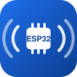
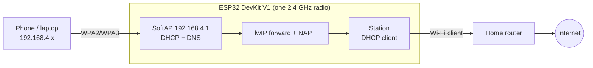

<div align="center">



# ESP32 Wi-Fi Repeater

**Secure-by-default Wi-Fi range extender firmware for the ESP32 DevKit V1, built reproducibly from the established ESP32 NAT Router project.**

[](https://github.com/espressif/esp-idf/releases/tag/v5.5.4)
[-1f6feb)](docs/BUILD_AND_FLASH.md)
[](tools/repeater.py)
[](LICENSE)
[](docs/TEST_PLAN.md)
<!-- After publishing on GitHub, add the CI badge:
[](https://github.com/OWNER/REPO/actions/workflows/ci.yml) -->

[Overview](#overview) ·
[**Step-by-step guide**](docs/FLASHING_GUIDE.md) ·
[Getting started](#getting-started) ·
[Usage](#usage) ·
[Architecture](docs/ARCHITECTURE.md) ·
[Build & flash](docs/BUILD_AND_FLASH.md) ·
[Test plan](docs/TEST_PLAN.md) ·
[Troubleshooting](docs/TROUBLESHOOTING.md)

</div>

---

## Overview

The board joins your existing 2.4 GHz router as a client and broadcasts a
separate, encrypted Wi-Fi network for phones and laptops. Traffic is routed
with NAT, so downstream devices get their own subnet (`192.168.4.0/24`), a
DHCP lease, DNS and internet access through the board.

The routing, DHCP, web UI and CLI come from
[martin-ger/esp32_nat_router](https://github.com/martin-ger/esp32_nat_router)
(pinned at v2.4.22, commit `119e0a3`). This repository adds what a careful
deployment needs on top: a pinned toolchain, a reproducible build, five
reviewed patches (security, validation, a build fix, and build-time Wi-Fi
settings), tests, and documentation for a beginner-friendly Windows
workflow.

New here? Follow the **[step-by-step guide](docs/FLASHING_GUIDE.md)**: it
covers flashing, where to enter your Wi-Fi names and passwords, what you can
change later, and adding a second repeater.

**Project status:** the firmware builds for the classic ESP32 with ESP-IDF
v5.5.4 and all host-side tests pass. **It has not yet been run on a physical
board**; every hardware test in the [test plan](docs/TEST_PLAN.md) is still
open.

### Hardware assumptions

| | |
|--|--|
| Board | ESP32 DevKit V1, 30-pin, ESP-WROOM-32 module (classic ESP32, 4 MB flash) |
| USB | CP2102 USB-to-UART bridge, Micro-USB |
| Radio | 2.4 GHz only (no 5 GHz) |
| Buttons | BOOT (GPIO0), EN (reset) |
| Power | USB 5 V for testing; optional 18650 + TP4056 + MT3608, see [power notes](docs/RANGE_AND_POWER.md#power) |

Other ESP32 families (S2, S3, C3, C5, C6) are out of scope for this build.

## Key features

- **Real IPv4 routing:** lwIP forwarding with NAPT, DHCP server, upstream DNS
  forwarded to clients; up to 8 clients.
- **Secure first boot:** the setup network is WPA2/WPA3 with your own
  passphrase, and the web UI requires your own admin password from the first
  second. The build fails rather than produce an open device.
- **All Wi-Fi settings in one file:** the repeater network, the admin
  password and, optionally, the existing Wi-Fi to join go into
  `config/secrets.local`, so a freshly flashed board can connect without the
  web UI. One file per board for a second repeater.
- **No secrets in git or logs:** credentials live in a git-ignored file; patch
  0002 stops upstream from logging Wi-Fi passwords and VPN keys.
- **Input validation:** malformed AP IPs, short AP passwords (which upstream
  silently turned into an open network) and over-long SSIDs are rejected.
- **Resilient uplink:** reconnect backoff from 250 ms to 16 s, no reboot loops;
  setup access stays available while the uplink is down.
- **Status and recovery:** `show status` (uplink, RSSI, channel, IPs, clients,
  uptime), `heap`, web status page; factory reset by holding BOOT for 5 s.
- **Reproducible build:** pinned upstream commit, ESP-IDF version and
  component versions; identical staging on Windows, Linux and CI.

## Demo

Web UI served by the firmware (screenshot from upstream at the pinned commit;
this build serves the same pages, behind a login):


Build output from this repository (Windows 11, ESP-IDF v5.5.4):

```text
> python tools\repeater.py build
[repeater] ESP-IDF 5.5.4 at C:\Users\nikad\esp\v5.5.4\esp-idf
[repeater] no build-time uplink: choose the Wi-Fi to repeat at http://192.168.4.1 after flashing
[repeater] exporting upstream 119e0a3d98a7 (v2.4.22) to build/src
[repeater] applied 0001-secure-first-boot-defaults.patch
[repeater] applied 0002-redact-credentials-in-web-logs.patch
[repeater] applied 0003-validate-ssid-passphrase-ap-ip.patch
[repeater] applied 0004-fix-mqtt-disabled-build.patch
[repeater] applied 0005-build-time-uplink-and-ap-ip.patch
[repeater] using pinned component versions from config/dependencies.lock
Bootloader binary size 0x58d0 bytes. 0x1730 bytes (21%) free.
esp32_nat_router.bin binary size 0x1423e0 bytes. Smallest app partition is 0x180000 bytes. 0x3dc20 bytes (16%) free.
[repeater] app image 1319904 bytes = 83.9% of the 1572864-byte OTA slot
[repeater] release images for esp32: build/release/esp32
```

Photos and serial logs from a running board will be added once the hardware
tests have been run.

## Architecture



- **NAT, not a Layer-2 bridge.** Clients are on a separate subnet behind
  double NAT and are not visible on the home LAN; discovery protocols (mDNS,
  casting) do not cross. Upstream's experimental Layer-2 branch was reviewed
  and not selected ([ADR 0001](docs/adr/0001-nat-router-over-layer2-bridge.md)).
- **One radio, one channel.** The AP always follows the home router's
  channel, and uplink and downlink share its airtime.
- **Build pipeline.** The upstream submodule is never edited: the pinned
  commit is exported with LF line endings into `build/src`, patched, and
  built with layered sdkconfig defaults.

Full design: [docs/ARCHITECTURE.md](docs/ARCHITECTURE.md).

## Getting started

### Prerequisites

- Windows 10/11 (Linux and macOS work too), Git, Python 3.9 or newer
- About 3 GB of disk for the ESP-IDF esp32 toolchain
- An ESP32 DevKit V1 and a data-capable Micro-USB cable
- A 2.4 GHz home network you own or are authorised to use

### Install

```powershell
# ESP-IDF v5.5.4, classic ESP32 toolchain only (path without spaces)
mkdir C:\Users\$env:USERNAME\esp\v5.5.4; cd C:\Users\$env:USERNAME\esp\v5.5.4
git clone -b v5.5.4 --depth 1 --recursive --shallow-submodules https://github.com/espressif/esp-idf.git
cd esp-idf; .\install.ps1 esp32

# This project, with its upstream submodule
git clone --recursive <this repository's URL> esp32-wifi-repeater
```

### Configure

```powershell
cd esp32-wifi-repeater
C:\Users\$env:USERNAME\esp\v5.5.4\esp-idf\export.ps1   # once per terminal
python tools\repeater.py init-secrets                   # writes config\secrets.local
```

`config\secrets.local` (git-ignored) is the one place for all names and
passwords:

| Line | Meaning |
|--|--|
| `CONFIG_REPEATER_SETUP_AP_SSID` / `_PASSWORD` | The network the repeater broadcasts (generated randomly; change freely) |
| `CONFIG_REPEATER_ADMIN_PASSWORD` | Web UI login (generated randomly) |
| `CONFIG_REPEATER_UPLINK_SSID` / `_PASSWORD` | Optional: your existing 2.4 GHz Wi-Fi, so the board connects on first boot |
| `CONFIG_REPEATER_AP_IP` | Optional: the repeater's address, default `192.168.4.1` |

Rules and examples: [`config/secrets.example`](config/secrets.example) and
[step 4 of the guide](docs/FLASHING_GUIDE.md#step-4-enter-your-wi-fi-details).

### Build and flash

```powershell
python tools\repeater.py build
python tools\repeater.py flash -p COM5 --erase --monitor   # your CP210x COM port
```

`--erase` wipes settings saved on the board, so the values from your secrets
file apply; settings saved on the board otherwise take precedence.

If flashing stops at `Connecting....`, hold **BOOT** until writing starts.
Step-by-step instructions, COM-port identification and the esptool
alternative: [docs/BUILD_AND_FLASH.md](docs/BUILD_AND_FLASH.md).

## Usage

If you set `CONFIG_REPEATER_UPLINK_SSID`, the board joins your Wi-Fi on its
own: just connect your devices to the repeater network. Otherwise:

1. Join the repeater network (SSID and password from `config\secrets.local`).
2. Open `http://192.168.4.1`, log in with the admin password.
3. On **Getting Started**, pick your home network (2.4 GHz), enter its
   password, and optionally rename the repeater network. Save; the board
   reboots and connects.
4. Join the repeater network from your devices.

Serial console (115200 baud, `python tools\repeater.py monitor -p COM5`):

| Command | Purpose |
|--|--|
| `show status` | Uplink state, channel and RSSI, IP addresses, clients, uptime, traffic |
| `show config` | Stored configuration (prints passwords to the local console) |
| `heap` | Free and minimum free heap |
| `scan` | Visible networks with channel and RSSI |
| `set_sta "<ssid>" "<password>"` / `set_ap "<ssid>" "<password>"` | Existing Wi-Fi / repeater network credentials (then `restart`) |
| `set_router_password <password>` | Change the admin password |
| `set_ap_ip <ip>` | Move the downstream subnet, e.g. `192.168.5.1` |
| `set_wifi_country <CC>` / `set_tx_power <dBm>` | Regulatory country and transmit power limit |
| `web_ui bind all` | Also allow the web UI from the home network |
| `factory_reset` | Erase all settings (same as holding BOOT for 5 s) |

### Limitations

- Range depends on antennas, placement, obstacles and the client device. The
  50–100 m open-space goal is a test target, not a promise; see
  [RANGE_AND_POWER.md](docs/RANGE_AND_POWER.md).
- Throughput is shared between uplink and downlink on one channel; upstream
  reports 5–15 Mbps, which has not been measured here.
- IPv4 only for clients; separate subnet; at most 8 clients.
- The web UI is plain HTTP (no TLS on the device). Keep it bound to the AP.
- Wi-Fi credentials are stored unencrypted in flash; physical access to the
  board reveals them. Your built images contain the setup passwords: never
  share `build/`.
- 5 GHz-only home networks are not supported by the hardware.

### Troubleshooting

Quick answers for the common cases; the full guide is
[docs/TROUBLESHOOTING.md](docs/TROUBLESHOOTING.md).

| Problem | First thing to check |
|--|--|
| No COM port | Data cable; Device Manager → *Ports*; CP210x driver only if missing |
| Flash stuck at `Connecting....` | Hold BOOT while flashing |
| Setup network not visible | Serial log for `AP started`; SSID is the one from `secrets.local` |
| Connected, no internet | `show status`; home subnet clashing with `192.168.4.x` → `set_ap_ip 192.168.5.1` |
| Home network not found | It may be 5 GHz-only; enable 2.4 GHz on the router |
| Forgot admin password | `set_router_password` on the serial console, or hold BOOT 5 s |
| Random reboots | `Brownout detector was triggered` → power supply ([power notes](docs/RANGE_AND_POWER.md#power)) |

## Project structure

```text
.
├── config/
│   ├── sdkconfig.defaults.repeater   # project overlay on upstream defaults
│   ├── secrets.example               # template (placeholders only)
│   ├── secrets.local                 # your credentials (git-ignored)
│   └── dependencies.lock             # pinned ESP-IDF component versions
├── patches/                          # changes applied to upstream at build time
├── tools/repeater.py                 # build / flash / monitor tool (stdlib only)
├── tests/
│   ├── test_repeater_tool.py         # unit + staging integration tests
│   └── host/                         # host C tests for the firmware's input validation
├── upstream/esp32_nat_router/        # git submodule, pinned, never edited
├── docs/                             # guides, architecture, ADRs, test plan
│   └── PROJECT_STRUCTURE.md          # detailed folder and file map
└── build/                            # generated: staged source, sdkconfig, images (git-ignored)
```

See the [detailed project structure](docs/PROJECT_STRUCTURE.md) for the
repository map and generated-file notes.

## Testing & quality

```powershell
python -m unittest discover -s tests -v   # 47 tests: secrets validation, staging, guards
python tests\host\run_host_tests.py       # 47 checks of the firmware's input validation
python tools\repeater.py build            # compile for the classic ESP32
```

| Check | Result (2026-10-23) |
|--|--|
| Firmware build, target `esp32`, ESP-IDF v5.5.4 | Exit 0; 2 warnings, both in the third-party WireGuard component |
| Python tests | 47 passed; 66 % line coverage of `tools/repeater.py` (stdlib `trace`) |
| Host C tests | 47 checks, 0 failures (MSVC `/W4 /WX`) |
| Hardware tests | Not run: no board was connected ([TEST_PLAN.md](docs/TEST_PLAN.md)) |

CI ([`.github/workflows/ci.yml`](.github/workflows/ci.yml)) is configured to
run the tests (host C tests with gcc `-Wall -Wextra -Werror -pedantic`) and a
full firmware build in the official `espressif/idf:v5.5.4` container. It has
not run yet because the repository has not been pushed to GitHub.

## Evaluation & benchmarks

Measured so far (build only):

| Metric | Value |
|--|--|
| App image | 1,319,904 bytes, 83.9 % of the 1536 KiB OTA slot |
| Bootloader | 22,736 bytes (0x58d0), 21 % of its region free |
| Clean build / no-op build | 95 s / 3 s (Windows 11, ccache warm); first build 304 s |

Throughput, latency, range and heap stability have **not** been measured.
The test plan defines how to measure them (T-17, T-18, T-23, T-29) and where
to record the results.

## Design decisions

| ADR | Decision |
|--|--|
| [0001](docs/adr/0001-nat-router-over-layer2-bridge.md) | NAT router instead of the experimental Layer-2 bridge |
| [0002](docs/adr/0002-upstream-submodule-with-patch-queue.md) | Upstream as a pinned submodule plus a patch queue, staged with LF line endings |
| [0003](docs/adr/0003-build-time-setup-credentials.md) | Build-time setup credentials instead of an open setup AP |
| [0004](docs/adr/0004-pin-esp-idf-5-5-4.md) | Pin ESP-IDF v5.5.4, build with `idf.py` |
| [0005](docs/adr/0005-minimal-feature-set.md) | Minimal feature set; MQTT compiled out |

## Documentation

| Document | Contents |
|--|--|
| [FLASHING_GUIDE.md](docs/FLASHING_GUIDE.md) | **Start here:** step-by-step flashing, Wi-Fi settings, customisation, second board |
| [ARCHITECTURE.md](docs/ARCHITECTURE.md) | Design, packet path, channel behaviour, state machine, security model |
| [BUILD_AND_FLASH.md](docs/BUILD_AND_FLASH.md) | Toolchain install, build, COM port, flashing, measured results |
| [TEST_PLAN.md](docs/TEST_PLAN.md) | Host and hardware tests with status |
| [TROUBLESHOOTING.md](docs/TROUBLESHOOTING.md) | Build, flashing, Wi-Fi, DHCP/DNS/NAT, power |
| [RANGE_AND_POWER.md](docs/RANGE_AND_POWER.md) | Antenna, placement, transmit power rules, battery wiring |
| [TWO_BOARD_PLAN.md](docs/TWO_BOARD_PLAN.md) | Chaining or pairing a second board |
| [LEARNING_PATH.md](docs/LEARNING_PATH.md) | Guided route through the project for beginners |
| [THIRD_PARTY_AND_BUILD_NOTES.md](THIRD_PARTY_AND_BUILD_NOTES.md) | Sources, versions, licenses, research date |

## Roadmap

- [ ] Run the single-board hardware tests (T-10 to T-28) and publish results
- [ ] Measure throughput, latency and heap under load
- [ ] Range walk with the stock PCB antenna
- [ ] Battery operation with 18650 + TP4056 + MT3608
- [ ] Two-board chain test
- [ ] Offer the patches upstream

## Contributing

Contributions are welcome; see [CONTRIBUTING.md](CONTRIBUTING.md) for the
patch workflow and [CODE_OF_CONDUCT.md](CODE_OF_CONDUCT.md).

## Security

See [SECURITY.md](SECURITY.md) for how to report vulnerabilities and for the
device's security model. Use this firmware only on networks you own or are
authorised to use.

## License

The contents of this repository (tooling, configuration, patches and
documentation) are released under the [MIT License](LICENSE). Upstream
`esp32_nat_router` is not redistributed here and has no repository-level
license; see [THIRD_PARTY_AND_BUILD_NOTES.md](THIRD_PARTY_AND_BUILD_NOTES.md).

## Acknowledgements

- [Martin Ger](https://github.com/martin-ger) for
  [esp32_nat_router](https://github.com/martin-ger/esp32_nat_router), which
  provides the routing, web UI and CLI this project builds on.
- [Espressif](https://github.com/espressif) for ESP-IDF, esptool and the mDNS
  and LED strip components.
- Kenta Ida and Daniel Hope for the WireGuard implementation used by upstream.
