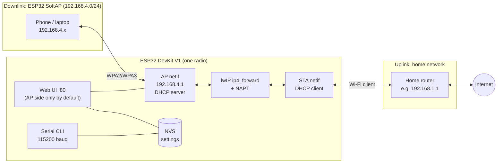
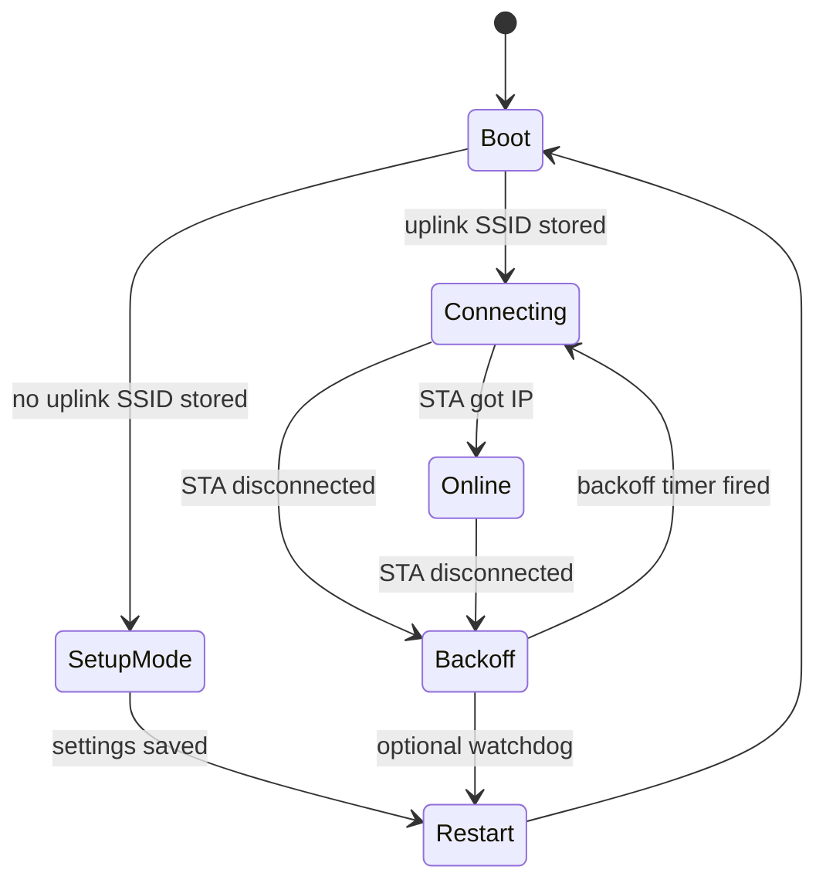
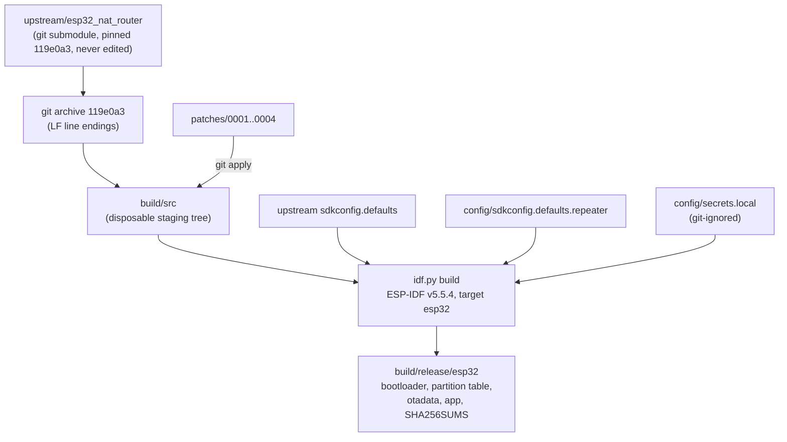

# Architecture and design

This document is the design record for the ESP32 DevKit V1 Wi-Fi repeater. It
explains what the firmware does, why it is built the way it is, and where its
limits are. Decisions with lasting consequences are also recorded as ADRs in
[`docs/adr/`](adr/).

- [1. Problem statement](#1-problem-statement)
- [2. Options considered](#2-options-considered)
- [3. Decision](#3-decision)
- [4. System overview](#4-system-overview)
- [5. Packet path, subnet and DNS behaviour](#5-packet-path-subnet-and-dns-behaviour)
- [6. Radio and channel behaviour](#6-radio-and-channel-behaviour)
- [7. Connection state machine](#7-connection-state-machine)
- [8. Security model](#8-security-model)
- [9. Build architecture](#9-build-architecture)
- [10. Resource budget](#10-resource-budget)
- [11. Limitations](#11-limitations)
- [12. Second board](#12-second-board)

## 1. Problem statement

Extend an existing 2.4 GHz home network to phones and laptops that are out of
range of the home router, using a classic ESP32 (ESP-WROOM-32) DevKit V1. The
board must:

- join the home router as a client (the *uplink*);
- broadcast its own, separately named network (the *downlink*);
- forward real IPv4 traffic between the two, with DHCP and DNS for clients;
- be configurable without editing source code, and secure from first boot.

A target of 50–100 m in open space was given. That is a radio question, not a
software one; see [RANGE_AND_POWER.md](RANGE_AND_POWER.md).

## 2. Options considered

Both candidates come from the same upstream author and share most of their
code. Each was reviewed at source level on 2026-10-23.

| | A. NAT router (`master`) | B. Layer-2 repeater (`esp32_wifi_repeater` branch) |
|--|--|--|
| Commit reviewed | `119e0a3` (v2.4.22, 2026-10-21) | `cec6ebe` (v2.4.12, 2026-10-16) |
| Upstream status | Main line; prebuilt binaries for 7 targets | Described by upstream as "still under development" |
| How clients get online | ESP32 runs a DHCP server on its own subnet (`192.168.4.0/24`) and NAPTs traffic out of the STA interface | Software MAC-translation bridge at the lwIP netif layer: IP→MAC forwarding table, DHCP transaction-ID proxying, proxy ARP |
| Client IP addresses | Private subnet behind the ESP32 | Same subnet as the home router |
| Visible on home LAN | No (only the ESP32's STA address) | Yes, by IP; the upstream router still sees only the ESP32's MAC (802.11 three-address limitation) |
| mDNS / casting / UPnP across sides | Blocked by the subnet boundary | Works (per upstream README) |
| Port forwarding, DHCP reservations, WireGuard | Yes | No |
| Mechanism maturity | lwIP `IP_FORWARD` + `IPV4_NAPT`, both stock ESP-IDF options | Custom frame rewriting in the project |

Standard AP+STA mode does **not** bridge on its own: an 802.11 station can
only send frames with its own MAC (three-address frames). A transparent
bridge needs four-address/WDS support on both ends or MAC translation in
software, which is what option B implements.

## 3. Decision

**Option A, the NAT router on upstream `master`, pinned to commit `119e0a3`.**
It is the established code path, uses only stock lwIP forwarding, and has the
features needed for operation (status, reconnect backoff, factory reset,
password-protected UI). Option B is promising but self-described as under
development, and its benefits (same subnet, discovery protocols) are not
requirements here. Full reasoning: [ADR 0001](adr/0001-nat-router-over-layer2-bridge.md).

The project does not fork or rewrite upstream. It pins upstream as a git
submodule and applies four reviewed patches at build time
([ADR 0002](adr/0002-upstream-submodule-with-patch-queue.md)):

| Patch | Why |
|--|--|
| `0001-secure-first-boot-defaults` | Upstream boots an **open** AP and an unauthenticated web UI on all interfaces. The patch makes the setup AP WPA2/WPA3 with a build-time passphrase, stores a build-time admin password (salted SHA-256) on first boot, and restricts the web UI to the AP side. The build fails if these values are missing ([ADR 0003](adr/0003-build-time-setup-credentials.md)). |
| `0002-redact-credentials-in-web-logs` | The `/config` and `/vpn` handlers logged the raw query string, which contains Wi-Fi passwords and WireGuard keys, to the serial console and syslog. |
| `0003-validate-ssid-passphrase-ap-ip` | `set_ap_ip garbage` was stored and left the AP on `0.0.0.0` after reboot; 1–7 character AP passwords silently produced an open AP; SSIDs over 31 bytes were truncated. Shared by CLI and web UI. |
| `0004-fix-mqtt-disabled-build` | The MQTT component broke CMake configure when compiled out, which this project does. |

## 4. System overview

Software layers, bottom to top:

| Layer | Provided by | Notes |
|--|--|--|
| Radio, 802.11 MAC, WPA2/WPA3 | ESP-IDF `esp_wifi` (closed blob) | `WIFI_MODE_APSTA` |
| TCP/IP, forwarding, NAPT | ESP-IDF lwIP with `CONFIG_LWIP_IP_FORWARD`, `CONFIG_LWIP_IPV4_NAPT`, `CONFIG_LWIP_L2_TO_L3_COPY` | Enabled by upstream defaults and restated in [`config/sdkconfig.defaults.repeater`](../config/sdkconfig.defaults.repeater) |
| DHCP server | Upstream `components/dhcpserver` (Espressif code, linker-wrapped) | Adds reservations |
| Event handling, reconnect, factory reset | Upstream `main/esp32_nat_router.c` | Event callbacks plus an `esp_timer` backoff; no blocking in handlers |
| Web UI, CLI, persistence | Upstream `components/http_server`, `components/cmd_router`, NVS namespace `esp32_nat` | Patched for security and validation |
| Build orchestration | This repository: [`tools/repeater.py`](../tools/repeater.py) | See section 9 |

## 5. Packet path, subnet and DNS behaviour

1. A client associates with the SoftAP and gets a DHCP lease in
   `192.168.4.0/24` with gateway `192.168.4.1` (the AP address, configurable
   with `set_ap_ip`; the netmask is always `/24`).
2. Its packets arrive on the AP netif, are routed by `ip4_forward`, and leave
   through the STA netif with source address and port rewritten by NAPT
   (`ip_napt_enable(my_ap_ip, 1)` in `app_main` and on every `GOT_IP`).
3. Replies are matched against the NAPT table and sent back to the client.

Consequences:

- **Separate subnet.** Downstream devices do not appear on the home LAN.
  Devices on the home LAN cannot open connections to them unless a port
  mapping is added (`portmap add TCP <ext> <client-ip> <port>`).
- **Double NAT.** The home router usually NATs too. Ordinary browsing,
  streaming and messaging work; inbound services and some games or VoIP
  setups may not.
- **Discovery does not cross.** mDNS/Bonjour, SSDP/UPnP, casting and printer
  discovery are link-local and stay on their own side.
- **IPv4 only.** lwIP NAPT is IPv4; downstream clients get no IPv6 internet.
- **Subnet clash.** If the home network itself uses `192.168.4.0/24`, routing
  fails. Change the AP subnet (`set_ap_ip 192.168.5.1`) — see
  [TROUBLESHOOTING.md](TROUBLESHOOTING.md#connected-but-no-internet).

DNS handed out by the DHCP server (from `wifi_init()` and the `GOT_IP`
handler):

| State | DNS offered to clients |
|--|--|
| No uplink configured (setup mode) | `192.168.4.1`; a captive-portal DNS answers every name with the ESP32 so the setup page opens |
| Uplink configured, not yet connected | `1.1.1.1` (upstream default) |
| Uplink connected | The DNS server the home router gave the STA, unless overridden with `set_ap_dns` |

## 6. Radio and channel behaviour

The ESP32 has one 2.4 GHz radio. In `WIFI_MODE_APSTA` the station and the
SoftAP share it and therefore share a channel. ESP-IDF v5.5.4 documents this
as *"the channel of the external AP, which the ESP station is connected to,
has higher priority over the ESP AP channel"*
(`docs/en/api-guides/wifi.rst`, `WIFI_MODE_APSTA`).

- The SoftAP is started on channel `0` (auto) and moves to whatever channel
  the home router uses. There is no independent downlink channel in this
  build; `set_ap_channel` exists only in the Ethernet-uplink variant.
- When the home router changes channel, the SoftAP follows; clients may drop
  briefly and reassociate.
- Uplink and downlink traffic take turns on the same channel, so every byte
  a client receives costs airtime twice. Expect noticeably less throughput
  than a direct connection to the router. Upstream reports 5–15 Mbps "under
  reasonable conditions"; this project has **not** measured throughput yet
  ([TEST_PLAN.md](TEST_PLAN.md), T-17).
- While the uplink is down, the station scans, which also takes airtime from
  connected clients. Upstream defers reconnect attempts during user-started
  scans and backs off between attempts (section 7).
- 5 GHz-only home networks cannot be used: the ESP-WROOM-32 radio is
  2.4 GHz only.
- Country rules: the default country code is `01` ("world-safe"). Set your
  own with `set_wifi_country <CC>`. In AP+STA mode with the default
  `WIFI_COUNTRY_POLICY_AUTO`, the AP adopts the country information of the
  connected station (ESP-IDF Wi-Fi guide, country code table).

## 7. Connection state machine

Upstream implements the uplink logic in event callbacks
(`wifi_event_handler`) with a one-shot `esp_timer` for backoff; nothing blocks
the event loop.

| State / transition | What the firmware does |
|--|--|
| Boot | Loads settings from NVS, starts AP+STA (`wifi_init`). Then, on a first boot only, patch 0001 stores the admin password hash and `web_bind=AP` (after Wi-Fi start, so the salt comes from the true RNG), and the web server starts. |
| SetupMode | AP and web UI at `192.168.4.1`, captive-portal DNS so the setup page opens by itself. |
| STA got IP (`IP_EVENT_STA_GOT_IP`) | Resets the backoff, re-enables NAPT, copies the uplink DNS to the DHCP server. |
| STA disconnected (`WIFI_EVENT_STA_DISCONNECTED`) | Schedules a reconnect with a one-shot `esp_timer`. |
| Backoff | Waits 250 ms, doubling on every failure up to 16 s. |
| Optional watchdog | Only if `set_watchdog N` is set (default off): restart after N s without uplink. |

Properties that matter for reliability:

- **Bounded backoff, no reboot loop.** Reconnect delay starts at 250 ms and
  doubles up to 16 s (`STA_RECONNECT_INITIAL_MS`, `STA_RECONNECT_MAX_MS`).
  The firmware never reboots because of a lost uplink unless the owner
  enables the watchdog (`set_watchdog <seconds>`).
- **Setup access survives bad credentials.** The SoftAP and web UI keep
  running while the uplink retries, so wrong uplink credentials can be fixed
  from `http://192.168.4.1` or the serial CLI.
- **Factory reset.** Holding BOOT (GPIO0 on the classic ESP32) for 5 s erases
  the `esp32_nat` NVS namespace and restarts (`led_status_thread`,
  `FACTORY_RESET_HOLD_MS 5000`). The serial command `factory_reset` does the
  same. After a reset the build-time setup credentials apply again.

## 8. Security model

| Surface | Default in this build | Upstream default |
|--|--|--|
| SoftAP | WPA2/WPA3 with the build-time passphrase | Open |
| Web UI (HTTP :80) | Password required; reachable from the AP side only | No password; AP, STA and VPN sides |
| Remote console (TCP :2323) | Disabled; uses the same router password | Same |
| PCAP stream, MCP bridge | Off | Same |
| Secrets in logs | Not printed (`get_config_param_str` hides secret keys; patch 0002 removes the raw query logs) | Query strings with passwords logged |

What remains true and is documented rather than changed:

- The web UI is plain HTTP. Anyone who can sniff the downlink after joining it
  can read a password typed into the UI. Use a strong Wi-Fi passphrase and
  keep the UI bound to the AP side.
- Wi-Fi credentials are stored in NVS as plaintext (upstream design). Physical
  access to the board (serial console or a flash read) reveals them. The
  serial command `show config` prints them, by design, to the local console.
- The firmware image embeds the build-time setup passphrase and admin
  password. Treat `build/` as secret; never publish your images.
- No flash encryption or secure boot is enabled (they are one-way eFuse
  operations and out of scope for a prototype).
- Only use this on networks you own or are authorised to use.

## 9. Build architecture

Why a staging export instead of patching the submodule: Git for Windows
defaults to `core.autocrlf=true`, which checks upstream out with CRLF line
endings; LF patches then fail to apply. `git archive` with
`core.autocrlf=false` always yields the committed LF bytes, so the patches
apply identically on Windows, Linux, macOS and CI. The submodule stays
pristine, and `build/src` is recreated whenever the pinned commit, a patch or
the component lock file changes.

ESP-IDF applies `sdkconfig.defaults` only when it creates a new `sdkconfig`.
The tool hashes all configuration inputs and regenerates the `sdkconfig` when
one changes, so editing `config/secrets.local` always takes effect.

Component versions fetched by the ESP-IDF component manager (mDNS, LED strip,
WireGuard) are pinned in [`config/dependencies.lock`](../config/dependencies.lock),
which is copied into the staging tree before each build.

## 10. Resource budget

| Resource | Value | Source |
|--|--|--|
| Max simultaneous AP clients | 8 | `AP_MAX_CONNECTIONS` in upstream `include/router_config.h` (about 5 KB RAM per client per upstream README) |
| DHCP server station table | 16 | `CONFIG_LWIP_DHCPS_MAX_STATION_NUM` (upstream defaults) |
| Flash | 4 MB; two 1536 KiB OTA app slots | upstream `partitions_example.csv` |
| CPU | 240 MHz, both cores | `CONFIG_ESP_DEFAULT_CPU_FREQ_MHZ_240` |
| App image size | measured per build; see [BUILD_AND_FLASH.md](BUILD_AND_FLASH.md#measured-build-results) | `build/release/esp32/build_info.json` |
| Free heap at runtime | not yet measured (requires hardware; `heap` command) | [TEST_PLAN.md](TEST_PLAN.md) T-18 |

Optional features that cost RAM (WireGuard, PCAP, remote console, MQTT) are
disabled at runtime by default upstream; MQTT is additionally compiled out
here.

## 11. Limitations

- One radio, one channel, shared airtime (section 6).
- Separate NATed IPv4 subnet; no IPv6 for clients; no cross-subnet discovery
  (section 5).
- At most 8 clients.
- Plain-HTTP management (section 8).
- Range depends on antennas, placement, obstacles and the weakest client
  device, not on firmware ([RANGE_AND_POWER.md](RANGE_AND_POWER.md)).
- Runtime behaviour has been reviewed in source and the firmware compiles,
  but **no physical-device test has been run yet**
  ([TEST_PLAN.md](TEST_PLAN.md)).

## 12. Second board

Chaining a second board (its uplink = the first board's AP) is supported by
configuration, with a different AP subnet on board 2, triple NAT and the same
channel for every hop. Flashing identical firmware to both boards does not
create a multi-hop repeater by itself. Details, configuration steps and
alternatives: [TWO_BOARD_PLAN.md](TWO_BOARD_PLAN.md).
