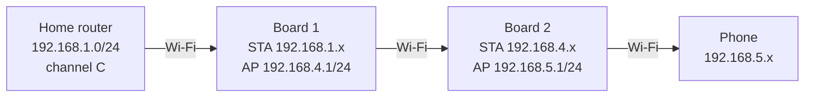
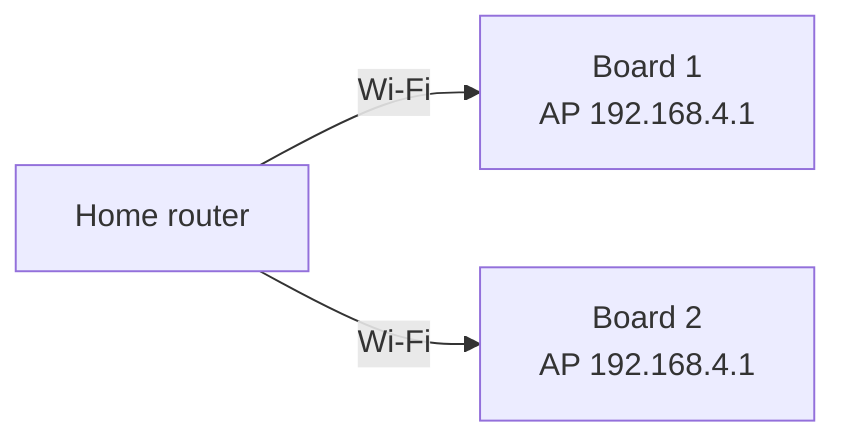

# Two-board plan

Status: **analysis only.** Nothing in this document has been tested on
hardware. Get one board working end to end first ([TEST_PLAN.md](TEST_PLAN.md)
T-10 to T-28), then try the topologies below.

Flashing the same firmware to two boards does not make a multi-hop repeater by
itself. Each board is an independent NAT router; how they relate depends only
on which network each board's uplink joins and how each is configured.

## Topology 1: chain (board 2 uplinks to board 1)



Supported by configuration: board 2's uplink is simply a Wi-Fi network,
which can be board 1's AP.

### Configuration (verified against the firmware source, not on hardware)

1. Set up board 1 normally: uplink = home router, AP e.g. `Repeater-1`.
2. Build board 2's image. Each board can use its own `config/secrets.local`
   values, or the same build for both; the setup SSID only needs to differ if
   both boards are in setup mode at the same time.
3. On board 2's **Getting Started** page (`http://192.168.4.1`), choose
   `Repeater-1` as the uplink and set a different AP SSID, e.g. `Repeater-2`.
   Save; board 2 reboots.
4. **Change board 2's AP subnet afterwards.** Board 2's uplink address is in
   board 1's `192.168.4.0/24`; if board 2's own AP also uses `192.168.4.1`,
   routing breaks. On the serial console of board 2:

   ```text
   set_ap_ip 192.168.5.1
   restart
   ```

   or use the AP IP field on the **Configuration** page. Do this *after*
   the Getting Started page: that page resets the AP IP to `192.168.4.1`
   (`setup_get_handler` in upstream `http_server.c`). `set_ap_ip` to a new
   `/24` also clears board 2's DHCP reservations and port mappings.
5. Optional: run `set_wifi_country <CC>` on both boards so both use your
   country's channel rules.

### What to expect

| Aspect | Behaviour | Basis |
|--|--|--|
| Addressing | Three subnets, triple NAT (home router, board 1, board 2) | NAPT on each board |
| Channel | Every hop on the home router's channel C: board 1's AP follows C, board 2's STA joins board 1 on C, board 2's AP follows C | ESP-IDF APSTA channel rule (ARCHITECTURE.md §6) |
| Throughput | Lower than one board. All four transmissions (router→B1, B1→B2, B2→phone and back) share the airtime of one channel; a common rule of thumb is roughly half per same-channel hop. **Estimate, not measured.** | Shared-channel store-and-forward |
| Latency | Adds per-hop queuing delay. Not measured. | |
| Roaming | No seamless roaming. Each network has its own SSID and subnet; moving between them means a new DHCP lease and new IP, which breaks open connections. Reusing one SSID would not fix that because the subnets still differ. | NAT design |
| Failure | If board 1 loses its uplink, board 2 stays associated to board 1 but has no internet. If board 1 disappears, board 2 backs off and reconnects when it returns (250 ms to 16 s). | Upstream reconnect logic |
| Client capacity | Board 2 occupies one of board 1's 8 client slots | `AP_MAX_CONNECTIONS` |

### Placement

Put board 1 where it still has a solid link to the home router (check `show
status` → `Uplink AP: connected (ch N, RSSI dBm)`; aim for roughly -67 dBm or
stronger), and board 2 where it has a solid link to board 1. Every hop is only
as good as its weakest direction, often the client's uplink back to the board.

## Topology 2: star (both boards uplink to the home router)



If both locations are within reach of the home router, configure both boards
with the home router as uplink. Each board is an independent single-hop
repeater, so neither depends on the other and there is only double NAT. Both
APs can keep `192.168.4.1`: they are separate networks. Both still share the
home router's channel. This is the better choice whenever the geometry allows
it.

## Layer-2 bridging with two boards

The upstream `esp32_wifi_repeater` branch implements single-board Layer-2
bridging in software. Whether two such boards can be chained, and how they
interact, has not been reviewed or tested here, and that branch is described
upstream as under development ([ADR 0001](adr/0001-nat-router-over-layer2-bridge.md)).
No claim is made that it works with two boards.

## When to use other hardware

The ESP32 DevKit V1 has a small PCB antenna, a single 2.4 GHz radio and shared
airtime. If reliable coverage at 50–100 m matters more than the learning
exercise, consider:

- an outdoor point-to-point bridge pair (CPE units with directional antennas)
  feeding a normal access point at the far end;
- a mesh Wi-Fi system with wired or dedicated-radio backhaul;
- an Ethernet or powerline link to a second access point.

These use proper antennas, separate backhaul channels and certified transmit
power. The ESP32 prototype remains useful for learning and for short ranges.
